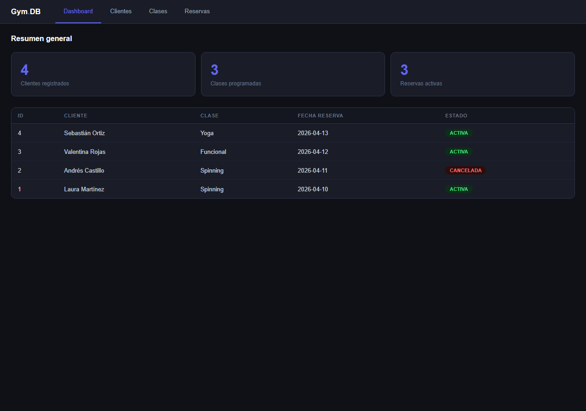

# 🏋️ Gym.DB: sistema de reservas para un gimnasio

Aplicación web para gestionar **clientes, clases e inscripciones** de un gimnasio, sobre una base de datos **Oracle** diseñada desde cero: modelo relacional, secuencias, triggers y control de cupos dentro de la propia base de datos.



## ✨ Funcionalidades

- 📊 **Dashboard** con clientes registrados, clases programadas, reservas activas y las 10 reservas más recientes
- 👤 **Clientes**: crear, editar y eliminar, con cédula y email únicos
- 🗓️ **Clases**: horario, capacidad máxima e instructor asignado
- ✅ **Reservas**: inscribir clientes en clases, cambiar su estado (activa o cancelada) y eliminarlas
- 🚫 **Control de cupos en la base de datos**: un trigger impide reservar cuando una clase ya está llena, aunque se intente desde fuera de la app

## 🗄️ Modelo de datos

```
INSTRUCTOR 1 ───< CLASE 1 ───< RESERVA >─── 1 CLIENTE
```

| Tabla | Qué guarda | Claves |
|---|---|---|
| `CLIENTE` | Cédula, nombre, email, teléfono, fecha de registro | PK `id_cliente` · únicos: cédula, email |
| `INSTRUCTOR` | Cédula, nombre, especialidad | PK `id_instructor` · único: cédula |
| `CLASE` | Nombre, fecha, horario, capacidad máxima | PK `id_clase` · FK instructor |
| `RESERVA` | Cliente, clase, fecha y estado | PK `id_reserva` · FK cliente y clase |

Lo que hace la base de datos por sí sola:
- **Secuencias + triggers `BEFORE INSERT`** generan los IDs automáticamente (Oracle 11g no tiene `IDENTITY`).
- **`TRG_CONTROL_CUPOS`** cuenta las reservas activas de la clase y lanza `ORA-20001` si ya no hay cupo.
- Las claves foráneas usan **`ON DELETE CASCADE`** para no dejar reservas huérfanas.

## 🔐 Buenas prácticas aplicadas

- **Consultas parametrizadas** en todas las operaciones (previenen SQL injection)
- **`COMMIT` / `ROLLBACK`** explícitos en cada transacción
- **Credenciales fuera del código:** se leen de un archivo `.env` que no se versiona
- Si la base de datos no responde, la app **sigue mostrando la interfaz** con un aviso, en vez de caerse

## 🛠️ Stack

`Python` · `Flask` · `Oracle Database` · `python-oracledb` · `PL/SQL` · `HTML` · `CSS` · `JavaScript`

## 🚀 Cómo correrlo

1. **Crea la base de datos:** ejecuta en SQL Developer (o SQL\*Plus) los scripts de `sql/` en orden:

   | Script | Qué hace |
   |---|---|
   | `01_esquema_y_datos.sql` | Tablas, secuencias, triggers y datos de ejemplo |
   | `02_consultas_verificacion.sql` | Consultas para revisar los datos |
   | `03_cupos_disponibles.sql` | Cupos disponibles por clase |

2. **Instala las dependencias:**
   ```bash
   pip install -r requirements.txt
   ```

3. **Configura la conexión:** copia `.env.example` como `.env` y completa usuario, contraseña y DSN. Si usas **Oracle 11g**, indica también `ORACLE_CLIENT_DIR` (carpeta `bin` del cliente Oracle) para activar el modo thick.

4. **Arranca la app:**
   ```bash
   python app.py
   ```
   y abre **http://localhost:5000**.

## 📂 Estructura

```
├── app.py              # Backend Flask: rutas y acceso a Oracle
├── templates/
│   └── index.html      # Interfaz (dashboard, clientes, clases, reservas)
├── static/
│   ├── style.css       # Estilos (modo oscuro)
│   └── app.js          # Frontend: navegación entre secciones, formularios y búsqueda en tablas
├── sql/                # Scripts de la base de datos
├── requirements.txt
└── .env.example        # Plantilla de configuración
```

## 🧠 Sobre el proyecto

Proyecto en equipo (Grupo G6) de la asignatura **Bases de Datos Relacionales**, Ingeniería de Sistemas, Universidad Libre (Cali).

## 👤 Autor

**Miguel Ángel González**: [GitHub](https://github.com/Exoticdevelopment) · [Portafolio](https://exoticdevelopment.github.io/mi-portafolio/) · [X](https://x.com/usuariomgz)
